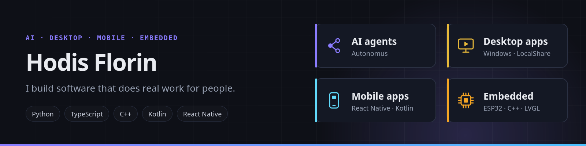

  

## Hi, I'm Florin 

I build software, and I like it most when it ends up doing real work for someone. My projects so far: an AI assistant, a few desktop and mobile apps, and a small gadget on an ESP32.

## What I'm working on now

My main project is **[Autonomus](https://github.com/H0dis/Autonomus-AI-company)**, an AI assistant for small businesses that runs on your own computer. You talk to an AI "COO", a team of AI workers does the job, and nothing goes out until you approve it.

I started it in September 2026. It knows the whole company, uses tools when it needs them, and later you'll be able to talk to it by voice.

The source code is private, but the repo has screenshots, the design and the results. If you'd like a walkthrough or a code review, just write to me.

I wanted to measure it, not just show a demo. So I gave it ten real small-business jobs and ran each one three times. The first run passed 1 of 10. The latest passed **27 of 30 (90%), at about $0.009 per job**. The project has around 1,900 automated tests.

  

## Smaller projects

- **[Vinyl Video Render](https://github.com/H0dis/Vinyl-video-render)**: a Windows app for record stores. You load a product photo, and it cuts out the cover and the disc and animates them onto the store's promo video.
- **[LocalShare](https://github.com/H0dis/LocalShare)**: send files between your PC and your phone over your home WiFi, with a shared clipboard. No cloud and no account.
- **[esp32-car-dashboard](https://github.com/H0dis/esp32-car-dashboard)**: a small digital dashboard on an ESP32 display that shows oil pressure, water temperature and oil temperature. Written in C++ with LVGL.

## What I work with

  
  
  
  
  
  
  
  
  
  
  

## Get in touch

If you'd like to talk about a project, or just say hi:

  
  

